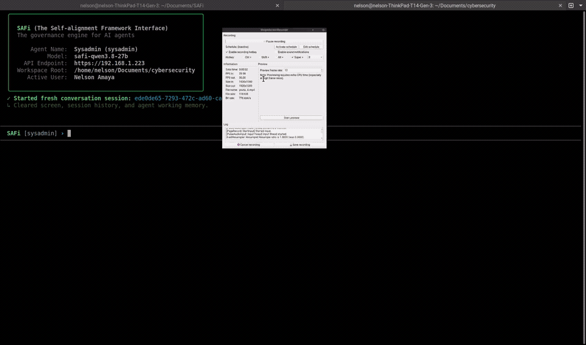

# SAFi - Self-Alignment Framework Interface

[](requirements.txt)
[](LICENSE)
[](https://safi.selfalignmentframework.com)
[](https://runsafi.com)

> SAFi is an open source governance gateway for AI agents. It lets you enforce your policies in real time, govern tool calls, and maintain an audit trail of every agent's action.

<p align="center">
  <a href="https://runsafi.com/assets/saficli_demo.mp4" title="Watch full HD terminal demo">
    
  </a>
  <br>
  <sub><em>SAFi CLI running live in the terminal — every tool call and answer is audited in real time against the governing policy. <a href="https://runsafi.com/assets/saficli_demo.mp4">Watch full HD video &rarr;</a></em></sub>
</p>

---

## Table of Contents

- [Quick Start — Install SAFi](#quick-start--install-safi)
  - [1. Install the SAFi CLI (`safi-cli`)](#1-install-the-safi-cli-safi-cli)
  - [2. Self-Host the SAFi Server (Docker)](#2-self-host-the-safi-server-docker)
  - [3. Prefer a Turnkey Hardware Appliance?](#3-prefer-a-turnkey-hardware-appliance)
- [Built-in Agents](#built-in-agents)
- [The Governance](#the-governance)
  - [The Five Faculties & Seven-Phase Loop](#the-five-faculties--seven-phase-loop)
- [Regulatory Readiness](#regulatory-readiness)
- [Sensitive Data Controls](#sensitive-data-controls)
- [Roles & Permissions](#roles--permissions)
- [For Developers](#for-developers)
- [Releases](#releases)
- [License & Governance](#license--governance)
- [About the Author](#about-the-author)

---

## Quick Start — Install SAFi

You can test **`safi-cli`** in under two minutes against the [live demo server](https://safi.selfalignmentframework.com) — or self-host the entire SAFi governance server on your own machine with Docker.

### 1. Install the SAFi CLI (`safi-cli`)

`safi-cli` runs on your workstation and connects to any SAFi server or appliance so your agents can inspect repositories, run tests, audit endpoints, and manage infrastructure under real-time policy governance.

**Windows 10 / 11 (PowerShell)** *(automatically configures WSL and core operational tools)*:
```powershell
irm https://runsafi.com/install.ps1 | iex
```

**Linux & macOS (Terminal)**:
```bash
curl -sSL https://runsafi.com/install.sh | bash
```

**Connect to a SAFi server or try the live demo:**
```bash
safi-cli --setup
```
1. Enter your SAFi server URL — use **`https://safi.selfalignmentframework.com`** to try the live demo immediately, or your own self-hosted / appliance URL (e.g., `https://192.168.1.200`).
2. Sign in with a **local account**, type **`sso`** for Google/Microsoft browser login, or press **Enter** to paste a Policy API key (`sk-safi-...`).
3. Start issuing tasks directly from your project directory. Use `/agents` to switch agents, `/models` to switch AI models, and `/audit` to inspect the full governance ledger for any turn.

---

### 2. Self-Host the SAFi Server (Docker)

The fastest way to run your own SAFi governance server locally. Includes MySQL — no external database needed.

```bash
# 1. Clone and enter the repo
git clone https://github.com/jnamaya/SAFi.git
cd SAFi

# 2. Configure your environment (generates secrets & validates your LLM key)
python3 scripts/setup.py

# 3. Start SAFi + MySQL
docker compose up
```

The setup wizard asks four things — what the instance is for, which AI provider you want to use, what port and URL to serve on, and an admin email — then writes a complete `.env` with freshly generated session, encryption, and database secrets. It needs nothing beyond Python 3 and Docker.

**Supported AI Providers (out of the box):** Local models (`llama.cpp` / OpenAI-compatible), `OPENAI_API_KEY`, `ANTHROPIC_API_KEY`, `GEMINI_API_KEY`, `GROQ_API_KEY`, `MISTRAL_API_KEY`, `DEEPSEEK_API_KEY`, `CEREBRAS_API_KEY`, and `ZHIPU_API_KEY`.

---

### 3. Prefer a Turnkey Hardware Appliance?

The **SAFi Appliance** ([runsafi.com](https://runsafi.com)) brings software engineering, systems administration, and security agents into your organization on dedicated on-premise hardware — powered by local AI models and governed by SAFi:

- **15-Minute Plug-and-Play Setup:** Connect power and Ethernet, log into the web portal, and pair `safi-cli` ([Quick Start Guide](https://runsafi.com/start)).
- **Zero Cloud Liability & True Air-Gap:** Your data, credentials, and IP never leave your physical network. Pull the network cable and all models, agents, and governance tools still run 100% locally.
- **3 Pre-Loaded Local Reasoning Models:** Ships ready on day one with **Qwen 27B**, **Qwen MoE 35B**, and **Gemma 4 (26B)** — zero cloud API keys or token meters, with zero artificial refusals on legitimate IT diagnostics (optional bring-your-own-key cloud providers supported).
- **Pre-Loaded IT Agent Triad:** **Software Engineering**, **Systems Administration**, and **Security** agents operating inside your written policies with Bubblewrap sandboxes and a tamper-evident local audit trail (plus unlimited custom agents via the web portal).
- **Predictable Economics:** Whisper-quiet edge hardware (high-bandwidth unified memory, 16-Core / 32-Thread CPU with dedicated AI acceleration, 1 TB NVMe SSD, 2.5 GbE + Wi-Fi 7, <120W) — **$4,500 one-time**, zero cloud token bills, with a 1-year advance-replacement warranty.

---

## Built-in Agents

SAFi ships out of the box with **three production CLI agents**, each bound to an active, versioned governance policy that enforces strict operational boundaries at runtime:

| Agent | CLI Key | Governing Policy | What It Does |
| :--- | :--- | :--- | :--- |
| **SAFi Coding Agent** | `software_engineer` | `Software Policy` | Inspects repositories, traces architecture, edits code, writes tests, and runs build/test commands locally. |
| **Security Engineer** | `security_engineer` | `Security Engineer Policy` | Runs authorized web/API assessments, OWASP Top 10 code audits, header/SSL/port checks, and defensive hardening. |
| **Systems Admin** | `sysadmin` | `Systems Admin Policy` | Diagnoses servers, inspects services/logs/disk/firewalls, and manages Linux, Windows, Azure, and M365 fleets via SSH & tools. |

### Build Your Own Agents — or Govern Existing Ones
- **Web Control Panel:** Author custom agents, attach internal **Knowledge Bases (RAG)**, and bind them to your organization's Charter and domain Policies.
- **External Agent Gateway (`/evaluate`):** Already have an agent stack? Route its drafts through SAFi's [`/evaluate` gateway](docs/DEVELOPER_GUIDE.md#9-the-evaluate-gateway) to enforce policy and record hash-chained audit evidence without rebuilding your orchestration.

---

## The Governance

Governance in SAFi is not an afterthought or a filter, but the natural result of how the system works. Based on thousands of years of classical thinking, SAFi enforces a strict **separation of powers**: the **Intellect** proposes, the **Will** decides, the **Conscience** evaluates, and the **Spirit** tracks long-term alignment.

### Policies, Charters & Client-Server Enforcement

- **Client-Server Control Plane:** Workstations run the thin `safi-cli` harness with zero LLM API keys and zero local policy overrides. Identity (SSO/LDAP/SCIM), models, Charters, Policies, and audit logs live centrally on your SAFi gateway.
- **Two-Tier Policy Compilation (Charter → Policy):** Every agent is bound to your **Organizational Charter**, a versioned **domain Policy** (such as `Software Policy`, `Security Engineer Policy`, or `Systems Admin Policy`), or both. Synderesis compiles them into weighted values, scope boundaries, and non-negotiable hard gates on every turn.
- **Pre-Execution Tool & Draft Enforcement:** Before any command runs or any answer is delivered, the deterministic **Will** enforces tool allow-lists, risk classes (`R0–R4`), parameter constraints, and PII checksums, while the independent **Conscience** scores drafts value-by-value against the governing policy.
- **Tamper-Evident Audit Trail:** Every turn, tool intent, Conscience ledger, enforcement decision, and exact policy version is written to a hash-chained audit trail — powering the **Audit Hub**, **Supervisory Review Queue**, and custody-logged exports.

### The Five Faculties & Seven-Phase Loop

| Faculty | Module | Role |
| :--- | :--- | :--- |
| **Synderesis** | `synderesis.py` | Foundational compiler. Assembles immutable baseline rules, scope boundaries, and weighted value sets from the Charter and Policy. |
| **Intellect** | `intellect.py` | Generative engine. Drafts responses or proposes tool calls inside an **Air Gap** — it can only emit *intents*, never execute them directly. |
| **Will** | `will.py` | Deterministic gatekeeper. Approves, blocks, or redirects proposals based on structural invariants and the Conscience ledger. |
| **Conscience** | `conscience.py` | Independent evaluator. Scores proposals against every policy rubric, producing a mathematical compliance ledger (−1.0 to +1.0 per value). |
| **Spirit** | `spirit.py` | Long-term memory. Integrates Conscience scores into a rolling alignment vector (EMA) to detect behavioral drift over time. |

Every user turn passes synchronously through seven phases:

| Phase | Name | What Happens |
| :--- | :--- | :--- |
| **Phase 0** | Pre-generation Gate | Deterministic threat screening, injection signatures, per-agent blocked phrases, sensitive-data checksums (Luhn/IBAN/ABA/SSN), and embedded-instruction detection before any model runs. |
| **Phase 1** | Scope & Context | Scope preflight and context retrieval (RAG knowledge bases, working memory, tool/plugin context). |
| **Phase 2** | Apprehension | The Intellect drafts a response or proposes a tool call. |
| **Phase 3** | Structural Will | Deterministic verification of structural invariants (allowed tool schemas, required disclaimers, syntax). |
| **Phase 4** | Conscience Audit | The Conscience scores the draft against the compiled rubrics, producing the compliance ledger. |
| **Phase 5** | Spirit & Alignment Gate | The Will checks hard gates; Spirit updates the alignment vector. Low or non-compliant scores trigger a governed Reflexion retry or redirect. |
| **Phase 6** | Safe Execution | The audited response or authorized tool call is finalized, hash-chained into the audit trail, and delivered. |

For the formal mathematical model, see the [SAFi Math Specification](https://selfalignmentframework.com/safi-math-specification/).

---

## Regulatory Readiness

SAFi's governance architecture was designed for auditability first, mapping onto major AI and record-keeping frameworks. Each readiness document states plainly what ships today and what remains on the roadmap — no certification claims.

| Field | What SAFi is designed to support | Readiness document |
| :--- | :--- | :--- |
| **Financial services (SEC / FINRA)** | SEA 17a-4 audit-trail alternative (hash-chained, tamper-evident records with re-creatable originals), Reg S-P incident response with notification clocks, retention & legal hold, examiner production exports, and FINRA 3110/3120-style supervisory review with auditable human sign-off. | [SEC / FINRA Readiness](docs/SEC_COMPLIANCE_READINESS.md) |
| **EU AI Act** | Limited-risk transparency tier: Art. 50(1) AI-interaction disclosure, Art. 50(2) machine-readable output marking, Art. 12 logging, Art. 13 per-decision explanations, Art. 14 human oversight, Art. 72 post-market monitoring, and Art. 73 incident clocks. | [EU AI Act Readiness](docs/EU_AI_ACT_READINESS.md) |
| **Healthcare (HIPAA)** | Per-org LLM provider allow-list with BAA-capable and zero-data-retention badges (fail-closed at every model call), application-layer encryption at rest, MFA and revocable sessions, §164.524 right-of-access export, breach-notification clocks, and device-copy kill switch. | [HIPAA Readiness](docs/HIPAA_READINESS.md) |
| **Data protection (GDPR)** | Self-service Art. 15 access export and written position reconciling Art. 17 erasure with retention obligations and legal-hold precedence. | [Data Erasure & Retention](docs/DATA_ERASURE_AND_RETENTION.md) |
| **AI management systems (ISO/IEC 42001)** | Machine-enforced versioned policy, role accountability with journaled sign-off, per-turn operation logs stamped with a deployment integrity fingerprint, continuous drift monitoring, and evidence exports. | [ISO/IEC 42001 Readiness](docs/ISO_42001_READINESS.md) |

> **The honest fine print:** these are platform capabilities designed to *support* a compliance program, not substitutes for one. Contractual items such as BAAs and zero-data-retention agreements with model providers remain the deploying organization's responsibility.

---

## Sensitive Data Controls

SAFi can block sensitive personal and financial identifiers before they reach a model and before a response containing one is delivered. Detection is deterministic code — three of the four checks are verified by arithmetic checksums so anyone holding the audit record can recompute the verdict.

| Check | Validation | Example detected |
| :--- | :--- | :--- |
| Payment card numbers | Luhn (mod 10) | `4111 1111 1111 1111` |
| IBAN | ISO 13616 mod-97 | `GB82WEST12345698765432` |
| Bank routing numbers (ABA) | 3-7-1 weighted checksum | `021000021` |
| US social security numbers | SSA allocation rules, formatted only | `123-45-6789` |

Every check is **off by default** and enabled per identifier under **Settings → Organization → AI Standards**. When a turn is blocked, the identifier is removed from the governance record in full while recording which check fired and at which stage.

**[Read the sensitive data controls documentation](docs/SENSITIVE_DATA_CONTROLS.md)**

---

## Roles & Permissions

SAFi enforces **four organization-scoped roles** (`admin` > `editor` > `auditor` > `member`) with **one deliberate separation-of-duties exception**: **editors cannot perform supervisory review**. Because editors author agents and policies, FINRA 3110/3120 supervision requires an independent `auditor` or `admin` to sign off on turns.

| Capability | `member` | `auditor` | `editor` | `admin` |
| :--- | :---: | :---: | :---: | :---: |
| Chat with org agents, use `safi-cli`, view own turn verdicts & governing Charter/Policy | ✅ | ✅ | ✅ | ✅ |
| **Audit Hub** — KPIs, drift trends, log explorer, hash-chain verification, export | — | ✅ | ✅ | ✅ |
| **Supervisory review** — sampled queue, dispositions, coverage reports | — | ✅ | **—** | ✅ |
| **Authoring** — create/edit agents, policies, versions, tools, and Policy API keys | — | — | ✅ | ✅ |
| **Org administration** — members, SSO/SCIM, MFA mandate, retention, legal hold, provider allow-list, examiner exports | — | — | — | ✅ |

- **Organization scoping:** Enforced in both API routes and SQL queries.
- **Immediate session revocation:** Role changes revoke active sessions and journal the change in the same transaction.
- **Supervisory separation:** Reviewers cannot dispose of turns from their own conversations (enforced in the data layer).
- See **[Enterprise Features](docs/ENTERPRISE_FEATURES.md)** and [`safi_app/core/rbac.py`](safi_app/core/rbac.py) for full details and documented limitations.

---

## For Developers

Working on the code or building integrations? Start with the **[Developer Guide](docs/DEVELOPER_GUIDE.md)** and the **[Governance Artifact Specification](docs/GOVERNANCE_ARTIFACT_SPECIFICATION.md)** (field-by-field contract for per-turn records, conscience ledgers, tool-call entries, hash chain, and integrity stamps).

---

## Releases

SAFi ships on a **12-week (quarterly) release cadence**. For production, install a [tagged release](https://github.com/jnamaya/SAFi/releases/latest) and pin its published **TCB Fingerprint**. See the **[Release Process](docs/RELEASE_PROCESS.md)**.

---

## License & Governance

SAFi is licensed under [AGPL-3.0](LICENSE), with a Section 7 exception that keeps an organization's own charter, policies, tools, branding, and data fully private — the copyleft applies to the Core Loop, not to what you configure on top of it.

- **[SAFi License & Governance Agreement](docs/SAFi%20License%20%26%20Governance%20Agreement.md)**
- **Verify a deployment:** `python scripts/verify_integrity.py` — recomputes the Core Loop's TCB Fingerprint against the release manifest and checks structural invariants.
- **[The SAF License](https://selfalignmentframework.com/license/)** — the philosophy and framework are free to use with attribution.

---

## About the Author

**Nelson Amaya** is a Cloud & Infrastructure IT Director with more than 22 years of experience in the IT industry, and the architect of SAFi.

- **Read the Philosophy:** [selfalignmentframework.com](https://selfalignmentframework.com)
- **Connect on LinkedIn:** [linkedin.com/in/amayanelson](https://www.linkedin.com/in/amayanelson/)
- **Follow on X:** [@nelsonamaya_](https://x.com/nelsonamaya_)
- **Follow on Reddit:** [u/forevergeeks](https://www.reddit.com/user/forevergeeks/)
